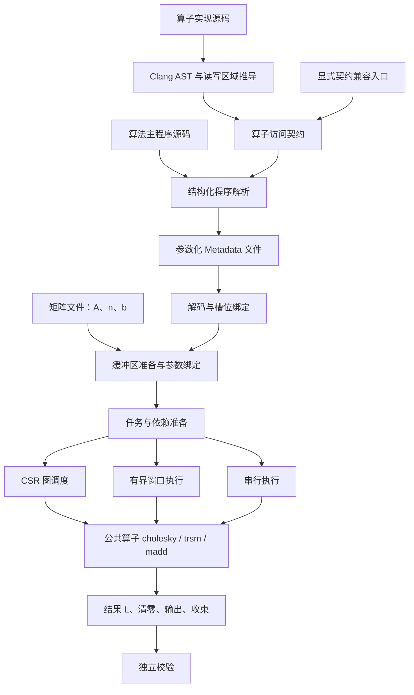
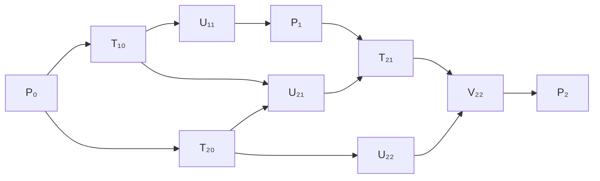

# 架构设计：从算法源码到动态并行执行

本文按讲课顺序解释当前实现：先建立概念，再跟踪一个分块 Cholesky 示例，最后讨论存储、调度、资源和评测。面向需要理解方案、阅读源码或进行技术答辩的读者。

本文是实现说明，**唯一需求规范仍是 [REQUIREMENTS.md](../REQUIREMENTS.md)**。以下算法图是教学示例，不是运行时内置的 Cholesky 依赖模板。实现核对日期：2026-10-31。本文不引用已清理的历史性能报告，不宣称已完成正式库或 Kunpeng 验证。

## 第一课：我们要解决什么问题

设输入为正定矩阵 A，目标是求下三角矩阵 L，使：

```text
A = L × Lᵀ
```

数学计算由公共算子完成。项目的主要工作，是从算法程序中理解“哪些计算必须先做、哪些可以同时做”，再把可以并行的任务高效分配给线程。

例如，两次运算分别更新两个不同矩阵块，且只读取已经完成的公共输入，它们可以并行；如果第二次运算要读取第一次刚写出的块，就必须等待。

困难在于：矩阵宽度 n、块宽 b 在运行时才确定，块数 `q=n/b` 随输入改变。固定尺寸下画出一张 DAG 很容易，但不能为每个尺寸手写一张图。我们需要保存的是**一套能随参数变化的计算和访问规则**。

这对应 R-01、R-03、R-05、R-16：源码驱动、动态 Shape、可延拓、不硬编码实例图。性能重点是分块 Cholesky，其他算法用来检验同一机制的适用性（R-04、R-27）。

## 第二课：先区分五个对象

| 对象 | 回答的问题 | 何时产生 | 主要表示 |
| --- | --- | --- | --- |
| 算法源码 | 依次做哪些调用，循环和条件是什么？ | 项目输入 | 支持子集内的 C++ 源码 |
| 算子访问契约 | 一次调用读写哪些内存？ | 算子源码分析或显式契约输入 | 参数化读写区域 |
| Metadata | 如何根据参数描述计算及访问关系？ | 离线源码处理 | 紧凑二进制程序，可压缩 |
| Task | 当前参数下具体执行什么？ | 运行时绑定、展开或分窗口生成 | 算子、实参、读写区域、重复次数与增量 |
| Graph / 活动窗口 | 哪些任务已满足执行条件？ | 运行时依赖准备 | CSR 图，或一批已证明独立的任务 |

最重要的区别是：**Metadata 文件不是某个 n、b 下完整展开的节点与边清单。** 它描述一族可能的实例；runtime 拿到实际参数后才决定具体调用和依赖。

图节点也不必与一次算子调用一一对应。一个压缩任务可以代表连续多次调用；运行时仍逐次执行公共算子，没有把它们替换成自制融合内核。

## 第三课：完整流程与编译边界



另有一个工程上的程序构建阶段：C++ 编译器把 runtime、适配层和公共算子库链接为可执行文件。它与“分析输入算法源码、生成 Metadata”不是同一件事。

目前 CMake 在构建依赖中同时触发 Metadata 生成，因此执行一次构建命令可能同时做这两件事；这只是当前工具组织方式。`dag_run` 执行时不调用 Clang，而是读入已有 Metadata。

### 3.1 为什么算子契约不可缺少

考虑：

```cpp
madd(A, B, C, b, n);
```

函数名、指针和参数列表不足以告诉调度器 C 是只写还是读后写。实际更新需要读取 A、B 和旧 C，再写回 C。依赖分析必须掌握这些副作用。

当前 [infer_catalog.py](../compiler/infer_catalog.py) 使用 Clang 输出的 C++ AST，追踪参数、循环、指针偏移以及辅助函数，生成参数化的 `reads`、`writes`。例如，基址为 `arg2` 的 b×b 区域可表示为：

```text
buffer = L
 offset = arg2
 rows   = b
 cols   = b
 stride = n
```

这里的契约描述访问范围，并不要求重写算子的数学计算。Clang 不是执行数值运算，也不是在这里生成最终运行时 DAG。

自动分析的收益是减少手工契约、把访问语义连接回源码。它的限制也很具体：当前仅支持受限循环和可分析地址表达式；三角访问可能扩大为保守矩形；同步、可重入、内部单线程等字段并非都由分析器证明。对只有二进制的官方库，不能假定这套源码分析能直接恢复内部语义。

显式 catalog 仍可作为兼容输入。若其语义相同，使用显式契约并不会自动变成“手写算法 DAG”；关键在于它描述的是单个算子的访问，而不是把整个算法的依赖边写死。

### 3.2 算法主程序如何变成参数化程序

[compile.py](../compiler/compile.py) 的主程序前端是结构化语法解析器。它保留：

- 循环：起点、终点、步长和循环体。
- 条件与整数表达式：随 n、b、循环变量求值。
- 调用：算子身份、参数以及代入后的访问表达式。
- 复制、上三角清零等明确语义。
- 标量扩展中的元素赋值、算术和平方根。

内部可理解为 `Let / For / If / Call / Copy / ZeroUpper` 节点组成的程序树。比如 `&L[j*n+i]` 在编译时保留为地址表达式，不提前枚举所有 j。

**两个前端的职责不同：Clang 分析算子实现，结构化解析器分析算法主程序。** 接入 Clang 不等于已经支持任意 C++ 主程序；局部浮点累加变量、任意控制流等仍受当前语法子集限制，详见 [编译器说明](../compiler/README.md)。

## 第四课：用一个小矩阵理解依赖

把矩阵划分为 3×3 个块，令 `q=3`。下面只写下三角部分。教学记号不是实际 API 名：

| 记号 | 工作 |
| --- | --- |
| P₀ | 对角块 L₀₀ 的 Cholesky |
| T₁₀、T₂₀ | 用 L₀₀ 求出 L₁₀、L₂₀ |
| U₁₁、U₂₁、U₂₂ | 使用第0列因子更新对应尾部块 |
| P₁ | 对已更新的 L₁₁ 做 Cholesky |
| T₂₁ | 用 L₁₁ 求出 L₂₁ |
| V₂₂ | 使用第1列因子再次更新 L₂₂ |
| P₂ | 对最后的 L₂₂ 做 Cholesky |

部分必要顺序如下：



P₀ 完成后，T₁₀ 和 T₂₀ 可以同时做。U₁₁ 只依赖 T₁₀，不必为了数学依赖等待 T₂₀。U₂₁ 同时需要两块输入，所以必须等待二者完成。

注意 U₂₂ 和 V₂₂ 更新的是同一个目标块，必须保留更新顺序。并行化不能擅自交换有冲突的浮点更新，不能只凭“数学上可以相加”就改变执行顺序。

代码没有保存这张教学图。它根据源码顺序和实际访问区域推导上述约束。增加 q 会改变实例任务数，但不需要为新尺寸编写新图。

对当前 demo 的循环结构，逻辑数值调用次数为：

```text
cholesky: q
trsm:     q(q−1)/2
madd:     q(q−1)(q+1)/6
```

因此小 b 导致 q 增大，调用数按 q³ 增长。以 `n=4000,b=1` 为例，madd 调用约为 106.7 亿次。压缩图可以减少表示和调度成本，但在不改变公共调用规则的前提下，不会自动消灭这些实际调用。

## 第五课：Metadata 怎样做到小而可复用

当前默认 lean 表示把原程序的控制结构和访问规则编码为紧凑二进制。局部变量使用槽位编号，重复的执行身份使用编号引用；执行所需算子身份、缓冲区语义和访问规则仍保留。

编码器比较未压缩版本和 raw-deflate 版本，压缩时尝试两种已有策略并选较小的流。解码端恢复同一套程序语义。默认路径不带源码/契约 SHA、FNV 或原始局部变量名，不把审计信息放进计费文件（R-28）。旧格式保留兼容，不代表默认文件仍包含这些字段。

可以把三种体积想成不同问题：

```text
Metadata 字节：描述规则要多少空间？
运行时任务/边内存：当前 n、b 的调度状态要多少空间？
矩阵内存：A、L 的数值要多少空间？
```

对于同一支持的算法源码，n、b 通常不在生成 Metadata 时固定，因此同一份产物可用于多个合法形状。文件很小，不代表任务图和矩阵也小。也不能通过把必要语义藏在未计费的外部文件中来缩小 Metadata。

这项设计对应 R-05、R-16、R-24、R-28；收益来自“保存规则而不是枚举实例”，不是只依靠压缩算法。

## 第六课：从 Metadata 到具体任务

### 6.1 解码和槽位绑定

[metadata.cpp](../src/metadata.cpp) 首先把文件还原成 `Program`。随后把表达式、变量等降低为适合求值的结构：参数和循环变量对应槽位，运算对应内部操作码。

绑定 `n=12,b=4` 后，表达式 `j*n+i` 才得到当前迭代的具体偏移。例如 `j=8,i=4` 时，偏移为100，以 double 元素为单位。块访问并不需要复制成独立小矩阵；基址加偏移、块宽和主矩阵行跨度即可传给公共算子。

源码中的动态 Shape 在这里转成实例数据。运行时推导和求值属于准备开销，不能因为它们发生在第一次数值计算前就不计时。

### 6.2 Region：描述一次访问

```cpp
struct Region {
    std::string buffer;
    size_t offset, rows, cols, stride;
};
```

例如 `offset=100, rows=4, cols=4, stride=12` 描述四段行内连续区域：

```text
100..103
112..115
124..127
136..139
```

它不是 `100..139` 全部连续元素。中间的行间隙必须正确处理，否则容易建立多余依赖，甚至误判区域关系。

### 6.3 Task：一次调用或一段调用

```cpp
struct Task {
    std::string symbol;
    std::vector<Int> args;
    std::vector<Region> reads, writes;
    size_t repeat = 1;
    std::vector<Int> steps;
};
```

`repeat=1` 是普通调用；`repeat>1` 时，args 保存首个调用参数，steps 保存后续迭代的参数和访问偏移增量。read/write 区域覆盖该段迭代的聚合访问，用于段之间的依赖判断。

## 第七课：依赖是怎样推出来的

### 7.1 三类必须保留的冲突

按源码顺序扫描任务，对同一内存位置考虑：

| 前一个任务 | 后一个任务 | 依赖意义 |
| --- | --- | --- |
| 写 | 读 | RAW：后者必须读到新值 |
| 读 | 写 | WAR：不能在前者读完前覆盖数据 |
| 写 | 写 | WAW：保留写入顺序 |
| 读 | 读 | 没有写冲突，可共享输入 |

实现可以为访问单元维护“最近写者”和“尚需保护的读者”。读任务等待最近写者；写任务等待此前相关读者与写者，再更新状态。经过传递路径已经保证的顺序，不必为所有任务对逐一存边。

这一过程依赖访问语义，而不是识别某个算子名后套用 Cholesky 图公式。

### 7.2 规则几何的快速路径

[graph.cpp](../src/graph.cpp) 优先尝试把访问区域映射为对齐网格中的整数单元 ID。若各区域满足一致跨度、对齐和分区条件，就可以按单元维护读写状态，减少重复区间操作。

压缩任务覆盖多个竖直相邻单元时，也可用同一几何表示。对于稀疏远距离区域，不会为了网格而无条件分配巨大连续状态数组；几何条件或表示成本不适合时，转入通用路径。

这里的“块”由访问区域的几何性质得出，不是给 Cholesky 专门写的 tile 编号公式。

### 7.3 通用区间路径

无法使用规则网格时，分析器把各矩形拆为行区间，处理起止事件，区分哪些区域覆盖哪些物理位置。具有相同访问成员关系的区间可以共享冲突状态，再据此推导任务依赖。

这种方法能处理更多布局，代价是更多事件、排序和临时容器。最终图小，并不代表构图过程的峰值内存也小；资源预算需要考虑中间表示。

## 第八课：显式任务图怎样存储

当前 Graph 定义在 [core.hpp](../include/dag/core.hpp)：

```cpp
struct Graph {
    std::vector<Task> tasks;
    std::vector<size_t> offsets;
    std::vector<uint32_t> successors;
    std::vector<uint32_t> indegrees;
    size_t memory_bytes;
};
```

这是 CSR 邻接表。把所有节点的后继列表首尾拼接，用 offsets 指明每个节点的区间。

假设有三条边：`0→1、0→2、1→2`：

```text
tasks      = [T0, T1, T2]
offsets    = [0, 2, 3, 3]
successors = [1, 2, 2]
indegrees  = [0, 1, 2]
```

T0 的后继在 `[offsets[0], offsets[1]) = [0,2)`，取出 `[1,2]`；T1 的后继取出 `[2]`；T2 没有后继。

对于 V 个节点、E 条边，64位主机上边结构的主要数组占用约为：

```text
8 × (V+1) + 4 × E + 4 × V 字节
```

这不包括 Task、参数、Region、字符串、vector 容量、构图临时数据及执行器状态。不能把这个公式当成总内存估算。

CSR 的优点是遍历某节点后继时访问连续内存，避免每条边单独分配对象。代价是构图与转换仍要成本，而且这条路径原则上要持有当前实例的完整任务集合。

## 第九课：线程如何知道自己可以执行什么

图的 `indegrees` 是初始值，执行器另存可修改的剩余前驱计数 `remaining`。

```text
初始化：remaining[v] = indegrees[v]
        将 remaining[v] == 0 的任务放入就绪队列

线程取任务 u：
    执行 u 的公共算子调用
    对每个 u → v：
        remaining[v] -= 1
        若由 1 变 0，则 v 就绪
```

默认 atomic 后端通过原子计数协调完成通知。任务就绪不仅意味着“计数变零”，也意味着前驱对矩阵的写入对后继可见；计数同步与内存可见性要一起理解。

[runtime.cpp](../src/runtime.cpp) 维护每线程队列，线程先处理本地工作，无工作时尝试从其他线程窃取。一个刚就绪的后继可以留在当前线程直接继续，减少一次入队出队；其他后继仍发布给队列，并周期性照顾较早任务，避免一直沿一条链跑下去。

可选 owner 后端把通知交给目标任务所属线程处理，跨线程事件进入收件队列。这提供另一种通知组织方式，并不保证在所有负载上优于默认原子方案。

线程池跨 case 复用，但 case 本身顺序执行，不让后一个矩阵提前计算来掩盖前一个矩阵的成本（R-18）。

## 第十课：为什么还要压缩循环和分窗口

### 10.1 循环压缩：减少“调度对象”，保留“数值调用”

设循环执行 `call(offset0 + t×delta)` 共100次。如果参数按仿射关系变化，访问几何可以描述，而且能证明迭代间无读写冲突，就不必创建100份完整 Task。

可以分成若干连续段，每段保存：首项参数、repeat、steps、聚合访问区域。段内执行时按增量得到后续地址，避免每次重新解释同一表达式树。

该优化有两个收益：少存任务，少重复做参数求值和几何分析。代价是一个段在调度层成为更大的单位：其他任务可能要等待整段完成，段太大也可能减少可供线程分配的工作。

因此自动策略参考实际 worker 数分段，而不是一味追求最少节点。显式 `DAG_LOOP_CHUNK`、`DAG_LOOP_PARTS` 可用于诊断。无法证明可压缩时继续普通展开；不能凭循环长得像某算法就忽略冲突。

### 10.2 仿射模板复用

对于重复的二维循环，后续行往往只平移同一套地址表达式。当前 pattern 实现可在证明整个域的迭代独立后，建立一次参数/访问增量模板，随后平移复用，减少重复解释与临时分配。

注意“地址随循环线性变化”和“迭代独立”不是同一命题。例如 `L[i] = L[i-1] + 1` 地址很规则，但存在循环依赖，不能把所有 i 同时执行。

### 10.3 分窗口：不存完整边集

`enumerate_pattern` 从 Metadata 的循环和访问表达式证明一段迭代独立，将其放入有界窗口。执行器并行完成该窗口后，才能进入下一窗口。


窗口保存 `vector<Task>`，不为这些独立任务建立全局 CSR 和逐节点前驱计数。当前实现还使用窗口容量与内存预算约束活动任务数；不能将其理解为无限扩展的无界队列。

不能证明并行的区域按源码顺序推进。窗口回调返回就是完成屏障，所以下个窗口可以使用前一窗口的结果。

它与完整图的区别可以用前面的3块示例理解：完整图可能在 U₁₁ 完成后立刻启动 P₁，即使其他更新还没结束；窗口方案可能要等待整批更新完成。**窗口以更强的等待约束换取更少的状态和准备成本。** 当前没有跨阶段 lookahead，不能声称并行度与细粒度 DAG 完全相同。

| 执行表示 | 保留状态 | 优势 | 代价 |
| --- | --- | --- | --- |
| 普通 CSR | 实例任务、完整后继边、入度 | 精细解依赖，可跨阶段重叠 | 展开、建图与逐边通知成本 |
| 压缩任务＋CSR | 段任务及段间边 | 减少节点与求值 | 粒度变粗，可能延后后继 |
| Pattern 窗口 | 当前有界任务集合与窗口同步 | 避免全图存储及逐边通知 | 屏障限制跨窗口并行 |
| 串行流式 | 少量解释和任务状态 | 小工作量或资源紧张时可执行 | 缺少线程级并行 |

当前自动选择对分块应用 `q=n/b >= 64` 考虑 pattern；小规模保留图路径，还会结合模式、工作量、显式限制等条件决定是否串行。这个数是实现策略，不是需求上限，不保证对任意目标机最优。显式 `DAG_SCHEDULE=graph|pattern|auto` 用于选择路径。

## 第十一课：数据和资源的生命周期

输入和输出均为完整行主序矩阵。当前公开协议为：

```text
uint32 count
重复 count 次：uint32 n、uint32 b、n×n 个 double
```

A 和 L 是主要数值缓冲区；保存两份 n×n double 的基本存储量约为 `16n²` 字节，还要加上任务、图、线程池和算子临时空间。

主流程按 case 顺序运行，可复用 Metadata、线程池及矩阵已分配容量。新增区域仍在读取或计算前按实现要求初始化；已有线程池可承担并行初始化，减少主线程独自触页的成本。过大的闲置容量在预算压力下回收，容量复用不是无限保留内存。

资源预算基于实际允许的单 NUMA CPU 和进程限制，而不是写死24线程或固定256 MiB图预算。显式正值图预算只是额外上限；默认自动预算要先扣除矩阵实际容量、Metadata、线程池、工作空间等。

完整图准备失败时，只有在尚未开始数值操作的前提下，才允许清理候选状态并改走串行流式路径。一旦已经复制或调用算子并写入结果，就不能简单从头重跑；否则可能对已更新数据重复计算。pattern 边生成边执行，尤其需要遵守这一边界。

资源不足的结果要保留原因和限制来源，并按 R-26 排除算法速度统计。它既不是正确性自动通过，也不能被当成普通算法变慢，更不能把未完成任务填成零耗时。

## 第十二课：公共算子与通用性如何同时成立

正式分块应用的算子适配层位于 [main.cpp](../src/main.cpp)，调用公共 `cholesky / trsm / madd`。数值实现由统一库提供；调度器决定何时调用和传哪些地址，不替换内核。

适配层知道算子 ABI、参数数量和工作空间，这是执行绑定的职责。依赖图构建和窗口独立性证明则依赖 Metadata 的访问语义，不能把算法专用前驱公式藏在这些模块里。

标量 application 是独立的扩展绑定，执行编译器生成的表达式指令。朴素左看式 Cholesky、右看式标量 Cholesky、二维波前示例通过它验证其他依赖结构的适用性。它们不是正式分块算子的替代实现，也不参与分块性能排名。

添加算法时先判断：

1. 主程序是否属于当前支持的语法子集？
2. 算子访问是否可由源码推导，或有明确契约？
3. 是否需要增加新的公共 ABI 适配，而不是修改通用调度器？
4. 独立的结果预期是什么，如何验证动态 Shape 与多 case？

通用性不等于零成本支持任意 C++。当前方案的证据是共享表示、共享依赖机制与不同算法实例，而不是宣称已经完成通用编译器。

## 第十三课：怎样解释性能报告

当前 runtime 的完整计算计时包括：Metadata 加载/解码、分配初始化、参数求值、建图或窗口生成、建池、调度、公共算子、结果写内存和清零、必要收束。排除矩阵文件 I/O，独立校验在进程外进行（R-21）。

**源码分析与 Metadata 生成是否进入赛事总时间，仍按 O-08 待确认。** “离线编译”是阶段分类，不是免费计时的证明。若评测包含生成阶段，应另加其实际耗时，并明确按何种频次生成；不能把 runtime-only 样本改名成包含编译的端到端成绩。

理解字段时还要注意：

| 字段或概念 | 应如何理解 |
| --- | --- |
| Metadata bytes | 输入描述文件的实际字节数，与图内存分开 |
| prepare_seconds | 当前路径归入准备阶段的成本；pattern 的生成和执行交错，准备是扣除窗口执行后的部分 |
| execute_seconds | 不保证是纯算子时间，还可能包括执行器状态准备、同步和等待 |
| tasks | 当前统计强调逻辑调用数，不能直接当成压缩后节点数 |
| graph_bytes | 图路径为图表示估算；pattern 为活动任务容器峰值估算，不是进程 RSS |
| 完整时间 | 不能只用 prepare + execute 替代，其他初始化和收束也可能计分 |
| demo 原始时间 | 只包住 block_cholesky 调用，漏掉部分分配初始化释放，与 runtime 完整时间不同口径 |

常驻验证统一进入 [benchmark.py](../tools/benchmark.py)。分块输出通过配套 verifier 和必要数值检查；其他算法标记 functional_only，失败可使包含该门槛的命令失败，但不混入性能均值、加速比和排名。

`estimate-schedule` 的调度模型用于解释潜在并行度，不是端到端实测，也不是正确性证明。历史 benchmark 数据已清理，新结论应基于重新生成的当前报告。

## 第十四课：设计亮点与可验证的收益来源

| 设计 | 为什么有价值 | 成立条件与代价 | 关联需求 |
| --- | --- | --- | --- |
| 源码→参数化访问→实例依赖 | 同一描述随 n、b 变化，不需手写实例 DAG | 受前端和算子分析子集限制 | R-01/03/05/16 |
| lean Metadata 与编号化表示 | 保存语义所需最小描述，减少文件体积及无关解码负担 | 执行语义必须完整，不能藏外部答案 | R-16/24/28 |
| 槽位绑定与仿射增量 | 减少重复名称查找和表达式解释 | 非仿射部分继续一般求值 | R-06/16 |
| 访问几何网格快路径 | 规则矩形使用整数单元状态推导冲突 | 条件不满足则使用通用区间路径 | R-02/05/16 |
| 循环压缩 | 减少 Task 对象和重复准备 | 粒度过粗会降低并行机会；不减少公共调用次数 | R-06/17 |
| 有界窗口 | 避免巨大完整图和逐边通知 | 多了屏障，可能损失阶段重叠 | R-06/16/19 |
| 线程池、本地队列和就绪后继直续 | 降低建池和队列往返成本，利用空闲线程 | 工作窃取、同步与缓存争用仍有代价 | R-06/18/19 |
| 按预算复用矩阵容量 | 减少反复分配，兼顾内存压力 | 初始化、容量和最终释放仍计入计算 | R-18/21/25 |
| 功能门槛与性能统计分开 | 证明机制可延拓，同时集中优化正式分块负载 | 示例通过不等于全语法、全合法域覆盖 | R-04/23/27 |

这些是收益机制，不是已经在所有机器上测得的加速保证。尤其是源码分析成本、图准备成本、公共调用次数、关键路径、缓存带宽与同步开销，会随 n、b 和硬件改变相对比重。

## 源码阅读路线与需求索引

建议先看数据结构，再沿主流程追到具体算法，不必先通读所有实现：

| 顺序 | 文件 | 阅读重点 |
| --- | --- | --- |
| 1 | [core.hpp](../include/dag/core.hpp) | Program、Region、Task、Graph、Executor 的边界 |
| 2 | [main.cpp](../src/main.cpp) | 一个 case 的生命周期、预算、模式选择、算子调用和计时 |
| 3 | [compile.py](../compiler/compile.py) | 算法解析、访问契约代入、lean 编码 |
| 4 | [infer_catalog.py](../compiler/infer_catalog.py) | 从算子 AST 推导读写区域，理解支持范围 |
| 5 | [metadata.cpp](../src/metadata.cpp) | 解码、绑定、任务压缩、窗口独立性证明 |
| 6 | [graph.cpp](../src/graph.cpp) | RAW/WAR/WAW、网格与区间表示、CSR 输出 |
| 7 | [runtime.cpp](../src/runtime.cpp) | 就绪计数、队列、窃取、完成同步 |
| 8 | [resources.hpp](../include/dag/resources.hpp) | 获准 CPU、NUMA 和内存资源探测 |
| 9 | [benchmark.py](../tools/benchmark.py) | 正确性门槛、计时口径、功能算法隔离、资源排除 |

使用命令见 [README](../README.md)，更短的运行路径说明见 [运行流程与调度](runtime_strategy.md)，算子分析配置见 [算子源码分析](operator_source_inference.md)。本章的具体实现选择不新增需求；接口、评分和未完成条件始终以根目录规范为准。
