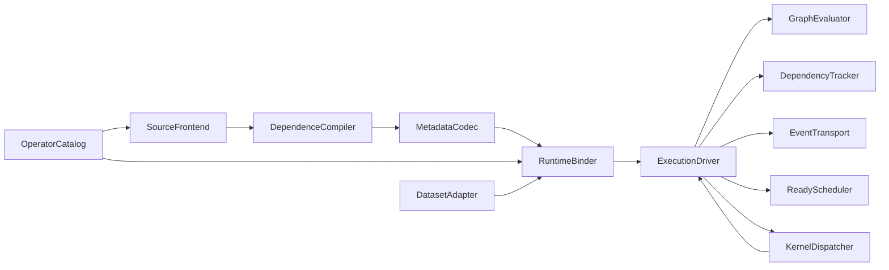

# 模块设计索引

> **非规范文档**：项目唯一需求与验收依据见 [REQUIREMENTS.md](../../REQUIREMENTS.md)。本页仅说明实现、使用方式、设计候选或历史验证；其中的约束性表述不能新增、覆盖或缩小规范要求。

## 目标与架构选择

目标是由源码推导动态依赖，用参数化 Metadata 驱动统一二进制库，在 Kunpeng-920 实际单 NUMA 允许集上优先优化给定 case 的总计算时间；泛化正确性必须保留，泛化性能为次要目标。约束来源见 [赛事附加信息](../supplemental_constraints.md)，整体语义见本文架构说明与 [共享契约](../contracts.md)；原 architecture.md 未包含在当前文档集中。本目录保留计算链路的逻辑模块设计；当前代码将这些职责合并在少量文件中，并未实现所有候选接口。各文档开头给出实现对照，当前实现见 [实现说明](../implementation.md)。

当前链路为：严格 Python 结构化 C++ 前端与外部访问契约 → 参数化程序/访问表达式 JSON Metadata → 实际参数展开 → 通用物理区域版本算法构造 CSR → 公共算子调用。前端无需 LLVM 或 pip，运行时没有整数集合求解器。Clang、离线符号关系与表达式共享压缩是保留的扩展候选。

运行时通过显式接口与事件连接模块；逻辑依赖通知不必都是跨线程消息。已实现连续任务计数、完整 CSR 后继和完成者直接原子递减，最终排空后重置；工作线程使用加锁本地队列与逐任务窃取。所有者消息后端也已实现，默认仍为 atomic。完整决策、预算条件及延后优化见 [运行时策略](../runtime_strategy.md)，不预设某后端实测必胜。

评分侧重点见 [需求规范](../../REQUIREMENTS.md)：图的准确性/并行约束和运行时成本服务于执行排名，紧凑 Metadata 服务于编码排名，图指标没有独立新增分值。三个正式接口及源码前后阶段已由 [demo 审查](../demo_review.md) 明确；可延拓性由算子契约和通用推导保证。

## 原设计职责目录

| 模块 | 唯一职责 | 输入 → 输出 | 设计文档 |
| --- | --- | --- | --- |
| SourceFrontend | 将支持的 C 源码结构化为任务族与访问 IR | 源码、访问契约 → TaskProgram | [源码前端](source_frontend.md) |
| OperatorCatalog | 管理可核对的算子语义与绑定描述 | 人工或官方声明 → OperatorContract、BindingDescriptor | [算子目录](operator_catalog.md) |
| DependenceCompiler | 从顺序访问语义构造参数化依赖图 | TaskProgram → SymbolicGraph | [依赖编译](dependence_compiler.md) |
| MetadataCodec | 对算法描述进行版本化序列化 | SymbolicGraph ↔ DecodedMetadata | [Metadata 编解码](metadata_codec.md) |
| RuntimeBinder | 校验实际参数、ABI 和资源并构造只读执行绑定 | Metadata、参数、缓冲区、资源 → BoundExecution | [运行时绑定](runtime_binder.md) |
| GraphEvaluator | 对已绑定任务域、关系和表达式进行纯求值 | BoundGraph、TaskKey → 任务、数量、参数值 | [图求值](graph_evaluator.md) |
| DependencyTracker | 把前驱到达事件转换为唯一就绪事件 | SourceTask、EdgeArrival → ReadyTask | [依赖状态](dependency_tracker.md) |
| EventTransport | 在工作线程间可靠交接控制事件 | 事件批次 → 接收端事件批次 | [事件传输](event_transport.md) |
| ReadyScheduler | 为已就绪任务分配执行者 | ReadyTask、WorkerId → TaskLease | [就绪调度](ready_scheduler.md) |
| KernelDispatcher | 依照 ABI 调用指定算子 | TaskInvocation → InvocationResult | [内核分派](kernel_dispatcher.md) |
| ExecutionDriver | 推进一次图执行的生命周期与进度 | BoundExecution → ExecutionResult | [执行驱动](execution_driver.md) |
| DatasetAdapter | 将文件协议转换为矩阵缓冲区并输出结果 | 输入文件 ↔ MatrixBatch、输出文件 | [数据适配](dataset_adapter.md) |

OperatorCatalog 是声明的来源；KernelDispatcher 是调用的执行者，二者不推导算法依赖。GraphEvaluator 计算调用参数但不调用内核。ExecutionDriver 连接接口并保障生命周期，不重做计数或队列策略。进程线程池与 CPU 放置属于执行生命周期，参数和资源是否合法属于绑定。

## 原设计数据流与构建边界

图中是逻辑接口使用关系；模块不相互持有具体实现。驱动通过轻量接口或可内联的静态策略组合热路径。编译器可执行文件链接前端、目录、依赖编译和编码器；提交执行程序链接解码器、绑定器、求值器、依赖状态、事件、调度、分派、驱动和数据适配，并静态链接官方内核库，禁用 LTO。验证工具独立构建。

运行时由驱动取得依赖模块的待发布 ReadyTask 并提交调度器，再将取得的 TaskLease 转换成调用；调度器不直接调用分派器。就绪发布确认通过依赖模块接口完成，避免驱动直接修改分片状态。

## 全局不变量

- 同一 TaskKey 表示同一执行中的一个有效任务；所有算术转换经过溢出检查。
- 依赖覆盖 RAW、WAR、WAW，沿原程序顺序前进；同一任务对只有一条逻辑边。
- 源任务域、任务总数、后继枚举和前驱计数来自同一 SymbolicGraph。
- 依赖状态由 DependencyTracker 管理；消息后端单写，原子后端按并发协议访问；就绪、执行、通知生效都恰好一次。
- 前驱内核写入通过完成事件和就绪队列的 release/acquire 链对后继可见。
- 资源不足时不得所有线程相互阻塞；未交接事件必须保留，无法继续则安全失败。
- 算法相关信息保存在计入统计的产物内；更换算法不修改 runtime 的依赖或队列代码。

