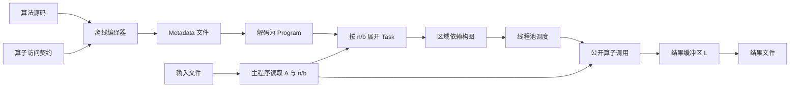

# 题面与当前实现对照：输入、输出与模块功能

> **非规范文档**：项目唯一需求与验收依据见 [REQUIREMENTS.md](../REQUIREMENTS.md)。本页仅说明实现、使用方式、设计候选或历史验证；其中的约束性表述不能新增、覆盖或缩小规范要求。

依据新提供的 [1.docx 正文转录](problem_statement.md)、[public20 I/O 说明](../vendor/public20/docs/io_format.md)、[demo I/O 头](../vendor/demo/include/matrix_case_io.hpp) 与当前源码核对。结论：整体目标一致，但**原始题面与 demo/public20 的二进制协议不同，现有程序须显式选择 public/original 协议，不能自动混用**。默认 public 保持兼容；original 分块模式要求显式给出 b，不替评委决定参数。

## 1. 对外输入输出：两种协议不可混用

### 原题面 1.docx

```text
输入文件：M:4字节
          重复 M 次：[n:4字节][A:n*n个double，行主序]

输出文件：M:4字节
          重复 M 次：[n:4字节][L:n*n个double，行主序]
```

原题面没有 `b` 字段，只写整数占 4 字节，没有明确整数有无符号及字节序；不能凭转录补成已明确的小端 uint32 协议。矩阵均完整存储 n*n 个 double，不能只输出 n(n+1)/2 个下三角元素。

### 当前 demo/public20 与程序

```text
输入文件：case_count:uint32
          重复 case_count 次：[n:uint32][b:uint32][A:n*n个double，行主序]

输出文件：case_count:uint32
          重复 case_count 次：[n:uint32][b:uint32][L:n*n个double，行主序]
```

当前实现与提供的头文件按宿主对象字节读写，uint32 为 4 字节、double 为 8 字节。输入须 b>0、n>0、b<=n、n%b==0；原题面没有给出这些分块字段/整除条件。

| 比较点 | 原题面 | 当前实现/公开包 |
| --- | --- | --- |
| 每条矩阵头 | n，占 4 字节 | n、b，共 8 字节 |
| 文件总长度 | 4 + Σ(4 + 8*n²) | 4 + Σ(8 + 8*n²) |
| n=3、单矩阵文件长度 | 80 字节 | 84 字节 |
| 输入矩阵 | A，double，行主序 | 相同 |
| 输出矩阵 | L，完整 n*n 数据 | 相同，严格上三角由程序清零 |
| 块大小来源 | 未交代 | 每条输入记录提供 b，程序原样使用并回写 |
| 多矩阵 | 同一文件多组不同 n | 支持，严格依次执行 |

`DAG_IO_FORMAT=original` 令主程序与 dag_check 按无 b 格式读写；分块执行须设置 DAG_BLOCK_SIZE 或逐 case 的 DAG_BLOCK_SIZES。默认 public 不猜测协议，不允许环境配置覆盖文件中的 b。原包生成器/public verifier 仍仅支持原包格式；自有基准入口会把显式协议传给程序及 dag_check。

双协议能力不决定赛事使用哪版；正式 b 来源和字节序仍按需求待确认项处理。

### 程序命令与文件数据是两层接口

当前命令行是 `dag_run input.bin output.bin`。矩阵参数来自文件，不是命令行参数。Metadata 通过 `DAG_METADATA` 指定，线程/模式/预算通过环境变量配置。原题面规定文件内容，没有规定这组命令行或环境变量接口。

`output.bin` 是要求的 L 结果文件；`DAG_STATS_FILE` 的 JSON 和 `COMPILER2026_TIMING_FILE` 的秒数文本只是诊断/计时产物，不代替结果文件。

## 2. 其他需要区分的要求

| 项目 | 原题面 | 当前状态与影响 |
| --- | --- | --- |
| 编译与执行两阶段 | 算法源码 → Metadata；Metadata + A → L | 已具备此链路 |
| 符号依赖表示 | 分析源码，生成“算子间符号依赖关系”的 Metadata | 当前保存参数化程序和访问表达式，具体依赖在绑定时通用构图；没有直接输出离线求解的参数化前驱/后继关系，是否满足题面对“符号依赖”的验收解释须确认 |
| 源码种类 | 朴素与分块 Cholesky 源码 | 完整支持提供的分块 demo；朴素样例现在直接使用矩阵元素算术并生成 scalar_expression。不是任意标量 C 源码编译器，题面提及但截图未包含的原始朴素源码尚无法逐句验证 |
| 运行入口 | 对不同算法输入生成相应结果 | 默认 blocked 模式只绑定 cholesky/trsm/madd；显式 scalar 模式可执行朴素表达式 Metadata；wavefront 仍需额外适配 |
| n 范围 | 3～10000 | n=10000 在 int 索引范围内，默认预算已改为资源快照规划，完整参数组合仍未穷尽；A/L 两个矩阵就需 1,600,000,000 字节，约 1.49 GiB，另需图、池和内核工作空间。校验器默认预算也须调整；增加预算不等于已证明所有 n/b 可运行 |
| 正确性 | “和真值数据相比完全一致” | 公开包按 scaled residual 判定，当前加强校验器同样用残差加有限值/正对角线检查；不把残差通过宣称为逐元素或逐位一致。正式比较方式须确认 |
| 工具选型 | “可以借助LLVM工具” | 属建议，未要求强制 LLVM；Python 严格子集前端本身不因未用 LLVM 而违背这句话，但覆盖范围仍有边界 |
| 动态 Shape | 必须支持，硬编码不得分 | 同一 Metadata 根据 n/b 展开任务；没有 case/seed/文件名特判或专用 Cholesky 后继生成 |
| 计时 | 输入输出文件时间不计入 | 当前排除矩阵文件 I/O，Metadata 加载/构图/建池等计入；这也遵循此前更具体澄清，不能从这句话推导 Metadata I/O 可免费 |
| 评分 | Metadata 15 分、性能 85 分，排名递减，下限各 0 分；正确结果总分为两项之和 | 原先文档把下限和总分规则列为未知，现在已补齐；并列与多 case 排名聚合仍未说明 |

正式公共算子库、单 NUMA、顺序执行和只测分块性能等约束来自后续材料/用户澄清；这份原题截图并未逐项写出，也不能因截图未写就撤销后续要求。新原文存在协议冲突，尚不能仅凭文件名确定哪版是最终评测协议。

## 3. 每个实际模块的输入、功能、输出

以下列实际代码边界；旧设计的 13 个逻辑模块并没有一一实现成独立组件。

| 模块/源码 | 输入 | 功能 | 输出 |
| --- | --- | --- | --- |
| 算子目录 `examples/catalog.json` | 人工核对的公共 ABI 与读写规则 | 声明各算子的参数类型、读写矩形及别名相关访问 | 受信 JSON 契约，供编译器查表；自身不生成图 |
| 离线编译器 `compiler/compile.py` | 支持子集的源码文件、catalog、入口名 | 解析循环/条件/调用，将契约替换为调用点的参数化访问表达式 | `.meta` 文件；可选可读 JSON。此时不输入矩阵 A 或具体 n/b |
| Metadata 解码 `src/metadata.cpp` | `.meta` 路径、资源 Limits | 校验容器与结构，解析表达式和程序树 | 内存 `Program`，含参数化节点、守卫、符号、输入摘要 |
| 参数绑定/任务展开 `src/metadata.cpp` | `Program`、`Parameters{n,b}`、Limits | 求值循环与条件，计算指针偏移和具体读写范围 | `vector<Task>`；或经回调按原顺序逐个输出 Task |
| 依赖图构建 `src/graph.cpp` | 按原程序顺序排列的 `vector<Task>`、Limits | 根据区域访问冲突建立 RAW/WAR/WAW 依赖，去重 | `Graph{tasks, offsets, successors, indegrees}`，即 CSR 图和初始入度 |
| 并行执行器 `src/runtime.cpp` | `Graph`、执行回调 `void(const Task&)`、RuntimeOptions | 维护就绪任务、依赖计数、线程池/窃取及失败收束 | 返回 `ExecutionStats`；回调的副作用写入结果缓冲区。执行器本身不返回矩阵 L |
| 算子派发 `src/main.cpp` 的 validate_task/invoke | Task、矩阵 A/L 缓冲区、n/b | 校验绑定和区域，默认调用公开算子或复制/清零；scalar 应用执行通用标量表达式 | 原地修改 L；不是生成新的 Metadata 或图 |
| 主程序与文件 I/O `src/main.cpp` | 输入路径、输出路径、环境配置、Metadata | 顺序读取每例、分配资源、调用上述流程并计时 | 显式选择协议的结果文件；可选统计 JSON/计时文本，退出码表示成功失败 |
| 独立校验 `tools/check_result.cpp` | 原输入文件、结果文件 | 对齐 case/n/b，检查有限值、正对角线及残差中间值 | 每例 PASS/FAIL 和残差文本；退出码 0/非0 |
| 基准 `tools/benchmark.py` | 可执行程序、输入、Metadata、运行配置、校验器 | 依次重复新进程运行，记录时间和校验/失败状态 | JSON 原始样本与成功样本统计；不生成比赛排名 |

共享类型见 [core.hpp](../include/dag/core.hpp)。关键区别：`Program` 是尚未绑定的程序；`Task` 是一次具体算子调用；`Graph` 是这些调用的先后依赖；`L` 是通过执行回调写入的数值结果。Metadata 文件、内存依赖图、矩阵结果文件是三个不同产物。



图示为并行路径。串行模式按 Program 原顺序流式调用，不经过构图与线程池；小任务 auto 也可在首次计算前选串行路径。

## 4. 三个公开数值算子的输入输出

这些参数中的 A/L/B/C 是每次算子调用的块指针，不一定是整张输入/输出矩阵的首地址；`b` 是块宽度，`lda` 是整矩阵的行跨度（当前为 n）。

| 公共接口 | 数值输入 | 数值输出/功能 |
| --- | --- | --- |
| `cholesky(A,L,b,lda)` | b×b 对角块 A | 将其 Cholesky 因子写入块 L，可按约定原地执行 |
| `trsm(A,L,X,b,lda)` | 已更新的非对角块 A、下三角对角块 L | 解 `X * Lᵀ = A`，写入 X |
| `madd(A,B,C,b,lda)` | 块 A、B 和 C 的当前值 | 原地更新 `C ← C − A*Bᵀ`；这里名称虽然叫 madd，实际是减去矩阵乘积 |

派发器额外处理 `__copy`（整矩阵 A→L）与 `__zero_upper`（清零 L 严格上三角）。这些是源程序语义步骤，不替代三个公共数值算子。
