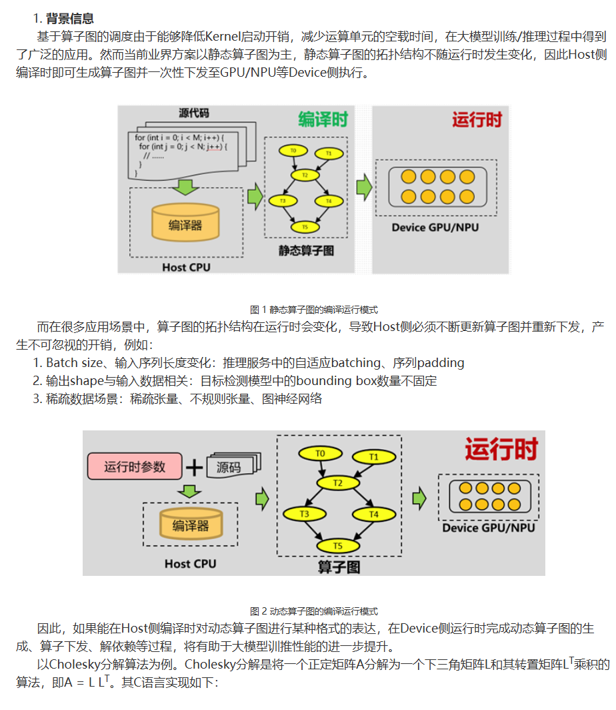
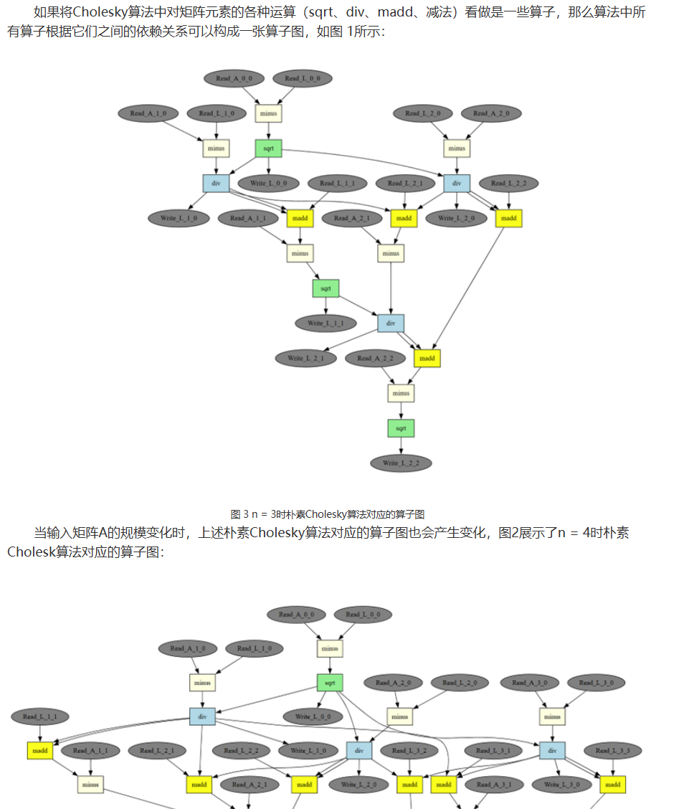
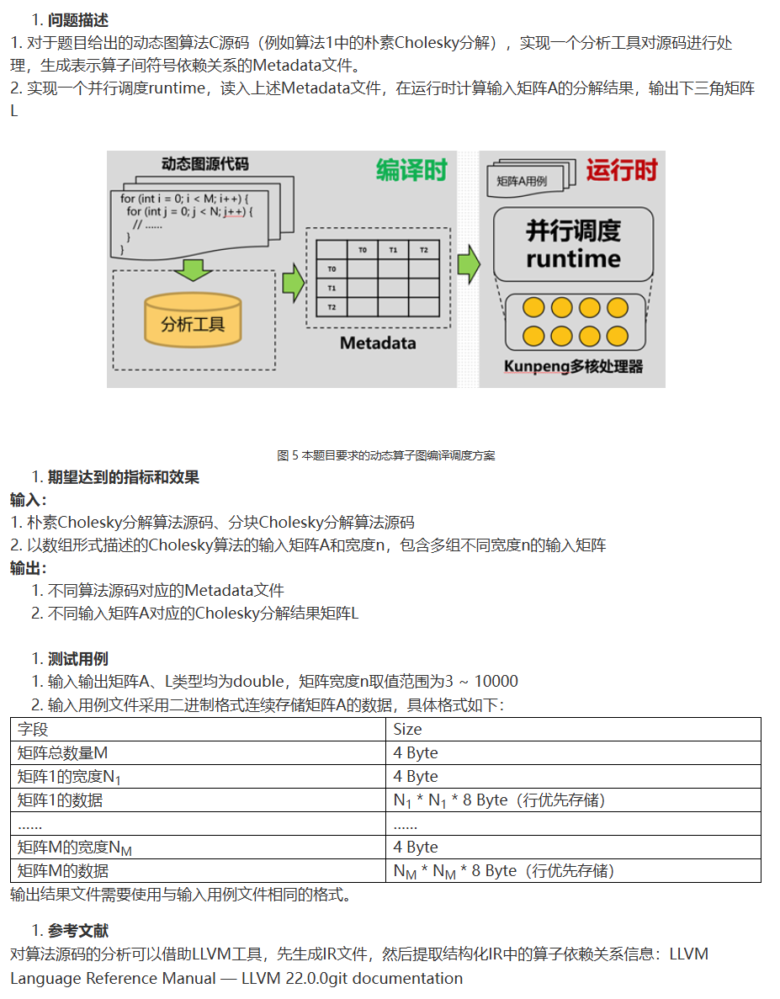
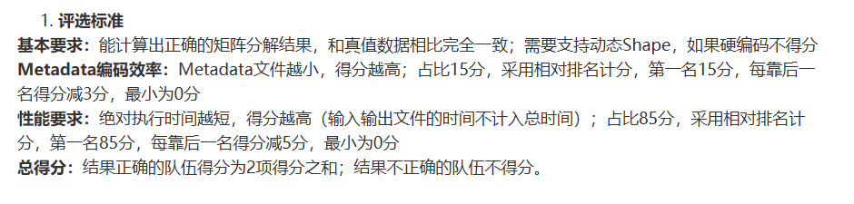

# 题目原文转录（1.docx）

> **来源附件**：本页保留题面转录及原图。项目唯一维护的需求与验收规范见 [REQUIREMENTS.md](../REQUIREMENTS.md)；发现转录或规范与原文不符时，应依据原文纠正，不以实现反推要求。

来源：[1.docx](../1.docx)。该文件正文由四张截图组成，没有可直接提取的正文文本。以下为逐图视觉识读、人工校对的正文转录；仅调整 Markdown 排版，公式用文本表示。图中的完整节点和箭头保留在原图中，不将示意图补写成算法源码。原图与来源 SHA-256 见 [记录](assets/problem-original/manifest.json)。

原文的章节编号、图号引用按截图保留，包含其编号不连续之处。截图写有“其C语言实现如下”，但这份文件中没有对应代码段；图 4 也仅有截断部分，不补造缺失内容。本页不混入 demo/public20 后续协议，差异见 [题面与实现对照](problem_alignment.md)。

---

## 1 背景信息

基于算子图的调度由于能够降低Kernel启动开销，减少运算单元的空载时间，在大模型训练/推理过程中得到了广泛的应用。然而当前业界方案以静态算子图为主，静态算子图的拓扑结构不随运行时发生变化，因此Host侧编译时即可生成算子图并一次性下发至GPU/NPU等Device侧执行。

*图1 静态算子图的编译运行模式（见原图1）*

而在很多应用场景中，算子图的拓扑结构在运行时会发生变化，导致Host侧必须不断更新算子图并重新下发，产生了不可忽视的开销，例如：

1. Batch size、输入序列长度变化：推理服务中的自适应batching、序列padding
2. 输出shape与输入数据相关：目标检测模型中的bounding box数量不固定
3. 稀疏数据场景：稀疏张量、不规则张量、图神经网络

*图2 动态算子图的编译运行模式（见原图1）*

因此，如果能在Host侧编译时对动态算子图进行某种格式的表达，在Device侧运行时完成动态算子图的生成、算子下发、解依赖等过程，将有助于大模型训推性能的进一步提升。

以Cholesky分解算法为例。Cholesky分解是将一个正定矩阵A分解为一个下三角矩阵L和其转置矩阵Lᵀ乘积的算法，即A = L Lᵀ。其C语言实现如下：

（转录注：原文件此处没有显示源码，下一张截图直接接以下文字。）

如果将Cholesky算法中对矩阵元素的各种运算（sqrt、div、madd、减法）看做是一些算子，那么算法中所有算子根据它们之间的依赖关系可以构成一张算子图，如图1所示：

*图3 n = 3时朴素Cholesky算法对应的算子图（见原图2）*

当输入矩阵A的规模变化时，上述朴素Cholesky算法对应的算子图也会产生变化，图2展示了n = 4时朴素Cholesky算法对应的算子图。

（转录注：原图2下方保留了另一张算子图的上半部分，后续内容在截图中被截断。）

## 1. 问题描述

1. 对于题目给出的动态图算法C源码（例如算法1中的朴素Cholesky分解），实现一个分析工具对源码进行处理，生成表示算子间符号依赖关系的Metadata文件。
2. 实现一个并行调度runtime，读入上述Metadata文件，在运行时计算输入矩阵A的分解结果，输出下三角矩阵L

*图5 本题要求的动态算子图编译调度方案（见原图3）*

## 1. 期望达到的指标和效果

**输入：**

1. 朴素Cholesky分解算法源码、分块Cholesky分解算法源码
2. 以数组形式描述的Cholesky算法的输入矩阵A和宽度n，包含多组不同宽度n的输入矩阵

**输出：**

1. 不同算法源码对应的Metadata文件
2. 不同输入矩阵A对应的Cholesky分解结果矩阵L

## 1. 测试用例

1. 输入输出矩阵A、L类型均为double，矩阵宽度n取值范围为3 ～ 10000
2. 输入用例文件采用二进制格式连续存储矩阵A的数据，具体格式如下：

| 字段 | Size |
| --- | --- |
| 矩阵总数量M | 4 Byte |
| 矩阵1的宽度N₁ | 4 Byte |
| 矩阵1的数据 | N₁ * N₁ * 8 Byte（行优先存储） |
| …… | …… |
| 矩阵M的宽度Nₘ | 4 Byte |
| 矩阵M的数据 | Nₘ * Nₘ * 8 Byte（行优先存储） |

输出结果文件需要使用与输入用例文件相同的格式。

## 1. 参考文献

对算法源码的分析可以借助LLVM工具，先生成IR文件，然后提取结构化IR中的算子依赖关系信息：LLVM Language Reference Manual — LLVM 22.0.0git documentation

## 1. 评选标准

**基本要求：** 能计算出正确的矩阵分解结果，和真值数据相比完全一致；需要支持动态Shape，如果硬编码不得分

**Metadata编码效率：** Metadata文件越小，得分越高，占比15分，采用相对排名计分，第一名15分，每靠后一名得分减3分，最小为0分

**性能要求：** 绝对执行时间越短，得分越高（输入输出文件的时间不计入总时间）；占比85分，采用相对排名计分，第一名85分，每靠后一名得分减5分，最小为0分

**总得分：** 结果正确的队伍得分为2项得分之和；结果不正确的队伍不得分。

---

## 原图核对

以下四张图片直接从 DOCX 提取，未修改图片内容。

### 原图1

### 原图2

### 原图3

### 原图4

